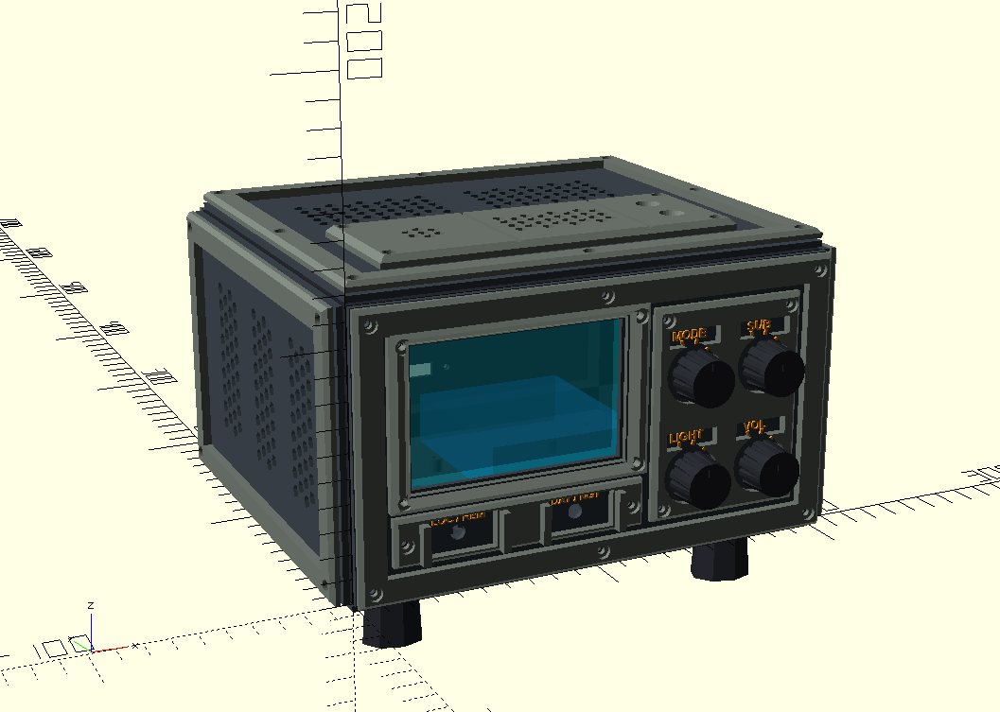

# 📦 05. Конструкция корпуса, 3D-печать, эргономика и OpenSCAD-модель (AetherCoreTerminalBestie)

## 1. Дизайн-концепция и архитектура «Трехслойный сэндвич»

Корпус терминала **AetherCoreTerminalBestie** спроектирован в форм-факторе классического настольного лабораторного осциллографа со строгой прямоугольной геометрией (`204 × 176 × 116 мм` без учета ножек). Для удобства обзора с рабочего места передняя часть прибора приподнята на угол **`~7.35°`** за счет разновысоких скошенных ножек (передние — `26 мм`, задние — `10 мм`), подошва которых срезана параллельно плоскости стола.

Для идеального качества поверхности на домашнем FDM-принтере (без поддержек, нависающих мостов и ступенек на лицевых гранях) корпус разделен на **три функциональных слоя (`L1 + L2 + L3`)**, где каждая внешняя панель печатается абсолютно плоской стороной на текстурированном PEI-столе:

1. **Слой 1 (`L1` — Внутренний несущий каркас-клетка, балки `12 × 12 мм`):**
   * Жесткая пространственная рама с угловыми косынками под 45° (печатается целиком без поддержек).
   * По периметру всех 6 граней выполнены отверстия `Ø4.0 мм` под вплавляемые латунные резьбовые втулки `M3×4×4.5`.
2. **Слой 2 (`L2` — Несущие монтажные панели, толщина `2.6 мм`):**
   * Плоские конструкционные листы, прижимаемые к каркасу `L1`.
   * Содержат все посадочные отверстия под электронику, вентиляционные шестигранные соты (`Honeycomb`), внутреннюю трехкамерную термо-ванночку датчиков на крыше, стойки плат на дне и неглубокие посадочные пазы (`0.4 мм`) для точного позиционирования накладок третьего слоя.
   * На наружной стороне панелей `L2` сформированы **выпуклые приборные шкалы и технические подписи** (высота букв `+0.8 мм`), которые остаются открытыми в окнах третьего слоя. Это позволяет легко выделить текст контрастным цветом без многоцветной системы (AMS) — через одну паузу на смену прутка (`Pause at Height`) в слайсере либо прокраской вершин букв акриловым маркером после печати.
3. **Слой 3 (`L3` — Модульная декоративная броня, толщина `3.8 мм`):**
   * Состоит из **чистых внешних контурных рамок** (ширина `11 мм` с фаской по периметру), которые притягивают листы `L2` к каркасу `L1` винтами М3, и **независимых накладных модулей («островков»)** без лишних соединительных перемычек.
   * Крупные модули `L3` (скошенная бленда экрана, приборная плита крутилок, кожух датчиков на крыше, восьмигранный диффузор динамика) прикручиваются собственными винтами М3 в потай, а малые накладки (защитный кожух тумблеров и портал USB Type-C) фиксируются винтами М3 или вклеиваются в готовые `0.4 мм` ложементы на слое `L2`.

## 2. Эргономика и распределение узлов по 6 граням корпуса

### 2.1. Лицевая панель (`front_L2` + `front_L3`, `204 × 116 мм`)
Лицевая панель разделена по классической компоновке осциллографа на мониторную зону слева и матрицу управления справа:
* **Левая верхняя зона (Монитор и подсветка):**
  * Окно `88 × 56 мм` под основной экран **`4.0" IPS TFT (ST7796, 480×320)`**.
  * Сверху накладывается массивная скошенная антибликовая бленда (`L3`) толщиной `5.8 мм`, создающая эффект глубоко утопленного Sci-Fi дисплея.
  * На обратной стороне бленды `L3` выполнен скрытый кольцевой паз глубиной `1.6 мм` под укладку светодиодной нити накала **`LED Filament 3V`**, а по углам окна экрана в панели `L2` предусмотрены сквозные отверстия `Ø1.8 мм` для вывода контактов нити внутрь корпуса к MOSFET-диммеру.
* **Левая нижняя зона (Тумблеры режимов):**
  * Два двухпозиционных металлических тумблера `МТВ` (`Ø6.2 мм`): слева — **`SW_SRC (LOC / REM)`** для мгновенного переключения между своей станцией и выбранным соседом, справа — **`SW_NIGHT (DAY / NGT)`** для переключения дневной/ночной палитры.
  * Накладной кожух `L3` оснащен выступающими на `4 мм` вертикальными защитными скобами («ушками») по бокам от каждого тумблера для защиты от случайного переключения и просторными окнами `28 × 15 мм`, открывающими выпуклые подписи на слое `L2`.
* **Правая приборная зона (Матрица крутилок 2×2):**
  * Четыре рукоятки с антиротационными пазами под усики корпусов (`Ø7.2 мм`), накрытые единой накладной бронеплитой `L3` (`66 × 88 мм`) с круглыми колодцами вокруг шкал и прямоугольными окнами над ручками под подписи:
    * **Верхний ряд:** **`MODE`** (`ENC_MODE` — переключение 6 главных режимов / Назад) и **`SUB`** (`ENC_SUB` — переключение подрежимов, слоев карт и ввод символов в меню / ОК).
    * **Нижний ряд:** **`LIGHT`** (`ENC_LIGHT` — ШИМ-диммер яркости и вкл/выкл нитей `LED Filament`) и **`VOL`** (вал потенциометра усилителя `PAM8403` с механическим щелчком полного выключения звука).

### 2.2. Верхняя панель — Сенсорная палуба и термо-ванночка (`top_L2` + `top_L3`, `204 × 176 мм`)
Чтобы восходящее тепло от микроконтроллера `ESP32-S3`, стабилизаторов питания и подсветки IPS-экрана не искажало показания термометра и газоанализатора, на внутренней стороне верхней крышки (`top_L2`) отлита **герметичная трехкамерная термоизолирующая ванночка (`156 × 60 мм`, глубина `20 мм`)** с кабель-каналами под вывод шлейфов:
1. **Камера 1 (Слева, внутренний габарит `55 × 55 × 20 мм`):**
   * Свободно вмещает крупный оптический датчик пыли **`Sharp GP2Y1014AU0F`** (`46 × 30 × 17.6 мм`) вместе с навесной RC-цепочкой (`150 Ом`, `220 мкФ`) и резисторным делителем (`10 кОм / 10 кОм`). Над центральным воздушным каналом датчика расположено круглое сотовое окно продувки `Ø22 мм`.
2. **Камера 2 (По центру, внутренний габарит `56 × 55 × 20 мм`):**
   * Отсек для комбинированного датчика газа/климата **`ENS160 + AHT21`** и барометра **`BMP280`** под широкой шестигранной сотовой решеткой `48 × 32 мм`.
3. **Камера 3 (Справа, внутренний габарит `35 × 55 × 20 мм`):**
   * Отсек для спектрометра света **`TCS34725`** и цифрового микрофона-шумомера **`INMP441`**. Датчики смотрят вверх через калиброванные отверстия `Ø4.5 мм` в слое `L2` и конусные акустико-оптические раструбы (`Ø4.8 ➔ Ø11.0 мм`) в накладном кожухе `L3`.
4. **Задняя конвекционная зона:**
   * Позади термо-ванночки расположены два больших сотовых окна (`68 × 42 мм`) для беспрепятственного выхода теплого воздуха из основного объема корпуса.

### 2.3. Боковые, задняя и нижняя панели
* **Правая панель (`right_L2` + `right_L3`):** Посадочное место с 4 внутренними направляющими стойками под широкополосный динамик **`40 мм (3 Вт, 4 Ом)`** и внешний восьмигранный акустический диффузор `L3` с сотовой решеткой (стягивается 4 винтами М3).
* **Левая панель (`left_L2` + `left_L3`):** Три вертикальные секции шестигранных сот (`32 × 68 мм` каждая) для свободной пассивной вентиляции, обрамленные чистой контурной рамкой `L3`.
* **Задняя панель (`rear_L2` + `rear_L3`):** Внизу по центру расположено окно `13 × 6.5 мм` с крепежными отверстиями под навесной разъем питания **`USB Type-C (Panel Mount)`**, защищенное внешним П-образным порталом `L3` с выпуклой маркировкой `5V DC // USB TYPE-C`. В верхней части выполнены два сотовых окна вытяжки (`66 × 34 мм`).
* **Нижняя плита (`bottom_L2`) и ножки (`accessories`):**
  * Изнутри на дне отлиты 4 опорные стойки высотой `6 мм` под плату расширения **`ESP32-S3 Screw Terminal Breakout Shield`** и 2 стойки высотой `5 мм` для жесткого крепления сейсмографа **`MPU6050`** непосредственно к дну корпуса.
  * Снаружи по углам дна выполнены 4 квадратных антиротационных паза (`10.4 × 10.4 мм`), в которые входят ответные квадратные шипы (`10 × 10 мм`) скошенных ножек — это исключает проворот ножек вокруг оси винта М3.

## 3. Спецификация крепежа и рекомендации по печати

### Необходимый крепеж (Метизы М3)
| Крепежный элемент | Размер | Кол-во | Назначение |
| :--- | :--- | :--- | :--- |
| **Латунные резьбовые втулки (Heat-Set Inserts)** | `M3 × 4 мм × Ø4.5 мм` | **32 шт.** | Вплавляются паяльником (220 °C) в 6 граней внутреннего каркаса `frame_L1` |
| **Винты с цилиндрической головкой под шестигранник (DIN 912)** | `M3 × 10 мм` (черненые) | **32 шт.** | Крепление пирогов панелей `L2 + L3` по периметру к каркасу `frame_L1` |
| **Винты DIN 912 + Гайки М3** | `M3 × 12..16 мм` + гайки | **18 шт.** | Крепление накладных модулей `L3` (бленда экрана, плита крутилок, кожух датчиков, диффузор динамика, тумблеры, USB-C) сквозь слой `L2` |
| **Винты для ножек** | `M3 × 16 мм` (2 шт.) и `M3 × 30 мм` (2 шт.) | **4 шт.** | Крепление задних (10 мм) и передних (26 мм) скошенных ножек к дну `bottom_L2` |

### Параметры 3D-печати
* **Материал:** `PETG` или `PLA Matte` (рекомендуемая цветовая схема: черный матовый для каркаса `L1`, ножек и ручек; темно-серый антрацит для панелей `L2`; индустриальный оливково-серый или титановый для рамок и модулей `L3`; янтарно-оранжевый или белый для вершин текста на `L2`).
* **Высота слоя:** `0.20 мм` (сопло `0.4 мм`), `3 периметра`, заполнение `20% Gyroid / Grid`.
* **Поддержки:** **Не требуются** (все детали в режимах экспорта автоматически ориентированы плоской базой на стол `Z = 0`, включая скошенные ножки в наборе `accessories`).

## 4. Как сгенерировать STL-файлы в OpenSCAD

1. Открой файл кода ниже в программе **OpenSCAD** (или в браузерной песочнице [ochafik.com/openscad2](https://ochafik.com/openscad2/)).
2. Нажми **F5** для быстрого цветного предпросмотра.
3. В правой панели **Customizer (Настройщик)** в выпадающем списке `view_mode` выбери нужный режим:
   * `"assembly"` — собранный прибор на скошенных ножках под углом `7.35°`.
   * `"exploded"` — интерактивная взрыв-схема всех трех слоев и внутренних 3D-макетов плат (`show_ghost_pcb = true`).
   * `"frame_L1"`, `"front_L2"`, `"front_L3"`, `"top_L2"`, `"top_L3"`, `"right_L2"`, `"right_L3"`, `"left_L2"`, `"left_L3"`, `"rear_L2"`, `"rear_L3"`, `"bottom_L2"`, `"accessories"` — отдельные печатные листы, уже уложенные плоско на стол принтера.
4. Для сохранения выбранной детали в `.STL` нажми **F6 (Render)**, а затем **F7 (Export as STL)**.

