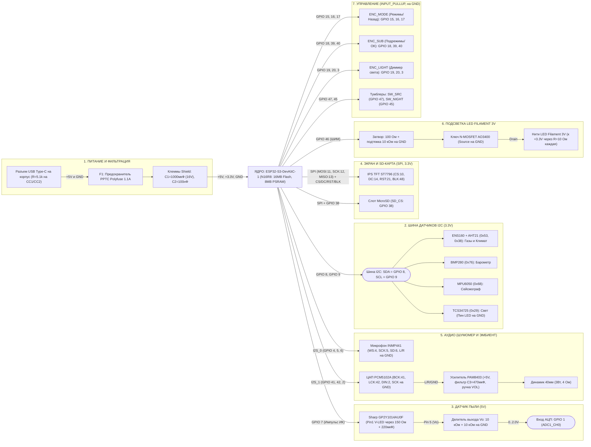

# ⚡ 06. Полная электрическая и логическая схема


## 1. Интерактивная структурно-электрическая схема (Mermaid)




## 2. Поузловые принципиальные схемы распайки (с обвязкой)

Каждый из 7 блоков ниже отформатирован по ширине 76 символов, чтобы верстка оставалась монолитной на любом устройстве.

### Узел А: Вход питания USB Type-C, защита и фильтрация шин
```text
[ Навесной разъем USB Type-C на корпусе ]
  (со встроенными резисторами 5.1 кОм на пинах CC1/CC2)
   │
   ├── Вывод [ VBUS (+5V) ] ──► [ F1: Предохранитель PPTC 1.1A ] ──┐
   │                                                               │
   └── Вывод [ GND ] ───────────────────────────────────────────┐  │
                                                                │  │
       ┌────────────────────────────────────────────────────────┘  │
       ▼                                                           ▼
[ Клемма GND ]                                              [ Клемма +5V ]
(Плата расширения ESP32-S3 Screw Terminal Breakout Shield)
       │                                                           │
       ├───[ C1: Электролит 1000 мкФ (16V) ] (Минус к GND, Плюс к +5V)
       ├───[ C2: Керамика 100 нФ (0.1 мкФ) ] (Параллельно в те же клеммы)
       │                                                           │
       ▼                                                           ▼
(Общая шина GND)                                     (Силовая шина +5V)
                                                     + Стабилизатор платы
                                                       формирует (Шину +3.3V)
```

### Узел Б: Оптический датчик пыли `Sharp GP2Y1014AU0F` (RC-цепь + Делитель АЦП)
```text
Шина [+5V] ──┬──► [ R_LED: 150 Ом ] ──┬────────────► Pin 1 (V-LED) [Пылемер]
             │                        │
             │                 [ C_LED: 220 мкФ ] (+ к Pin 1, - к GND)
             │                        │
Шина [GND] ──┼────────────────────────┴────────────► Pin 2 (LED-GND) и Pin 4 (S-GND)
             │
             └──(Питание усилителя датчика +5V)────► Pin 6 (VCC)

ESP32 [GPIO 7] ──(Импульс запуска ИК-диода)────────► Pin 3 (LED)

[Пылемер] Pin 5 (Выход Vo: 0..4.0V)
   │
   ▼
[ R_DIV1: Резистор 10 кОм ]
   │
   ├───► Подключить к ESP32 [ GPIO 1 (ADC1_CH0) ] (Напряжение здесь <= 2.0V!)
   │
[ R_DIV2: Резистор 10 кОм ]
   │
   ▼
Шина [GND]
```

### Узел В: Силовой ШИМ-диммер подсветки `LED Filament 3V` на MOSFET
```text
Шина [+3.3V] ──┬──► [ R_FIL1: 10 Ом (0.5Вт) ] ──► (+) [ Нить LED Filament №1 ] (-) ──┐
               ├──► [ R_FIL2: 10 Ом (0.5Вт) ] ──► (+) [ Нить LED Filament №2 ] (-) ──┼──┐
               └──► [ R_FIL3: 10 Ом (0.5Вт) ] ──► (+) [ Нить LED Filament №3 ] (-) ──┘  │
                                                                                        ▼
                                                                             [ Сток / Drain (D) ]
ESP32 [GPIO 46] ──► [ R_G: 100 Ом ] ──┬────────────────────────────────────► [ Затвор / Gate (G) ]
                                      │                                       N-MOSFET (AO3400)
                               [ R_PD: 10 кОм ]                              [ Исток / Source (S) ]
                                      │                                                 │
Шина [GND] ───────────────────────────┴─────────────────────────────────────────────────┘
```

### Узел Г: Аудио-тракт (`INMP441` + `PCM5102A` + `PAM8403` с фильтром)
```text
1) ЦИФРОВОЙ МИКРОФОН-ШУМОМЕР (INMP441, Питание +3.3V):
   • INMP441 [VDD] ──► Шина [+3.3V]       • INMP441 [WS]  ──► ESP32 [GPIO 4]
   • INMP441 [GND] ──► Шина [GND]         • INMP441 [SCK] ──► ESP32 [GPIO 5]
   • INMP441 [L/R] ──► Шина [GND] (!)     • INMP441 [SD]  ──► ESP32 [GPIO 6]

2) ГЕНЕРАТОР ЭМБИЕНТА (ЦАП PCM5102A ➔ Усилитель PAM8403 ➔ Динамик):
   • ESP32 [GPIO 41] ──► PCM5102A [BCK]   • PCM5102A [VIN] ──► Шина [+3.3V]
   • ESP32 [GPIO 42] ──► PCM5102A [LCK]   • PCM5102A [GND] ──► Шина [GND]
   • ESP32 [GPIO 2]  ──► PCM5102A [DIN]   • PCM5102A [SCK] ──► Шина [GND] (Перемычка!)
                                                   │
                        Аналоговый аудиовыход [L / R / GND]
                                                   │
                                                   ▼
   Шина [+5V] ──┬─────────────────────────► PAM8403 (с потенциометром и щелчком Вкл/Выкл)
                │                                  │
         [ C3: 470 мкФ (10V) ]                     ├── Выход [OUT+ / OUT-]
                │                                  ▼
   Шина [GND] ──┘                           [ Динамик 40 мм (3 Вт, 4 Ом) ]
```

### Узел Д: Шина датчиков I2C (`GPIO 8 / GPIO 9`)
```text
Шина [+3.3V] ──┬───────────────┬───────────────┬───────────────┬── (Питание 3.3V)
Шина [GND]   ──┼───────────────┼───────────────┼───────────────┼── (Общий GND)
               │               │               │               │
ESP32 [GPIO 8] ┼──► [SDA]      ├──► [SDA]      ├──► [SDA]      ├──► [SDA]
ESP32 [GPIO 9] ┼──► [SCL]      ├──► [SCL]      ├──► [SCL]      ├──► [SCL]
               ▼               ▼               ▼               ▼
         [ENS160+AHT21]    [BMP280]       [MPU6050]       [TCS34725]
         (0x53 и 0x38)      (0x76)         (0x68)          (0x29)
                                                           └──► Пин [LED] замкнуть
                                                                на [GND]!
```


## 3. Пошаговый монтажный чек-лист (Таблица цепей для сборки)

| № цепи | Узел | Откуда (Источник) | Через какой навесной элемент | Куда (Приемник) |
| :- | :--- | :--- | :--- | :--- |
| **01** | Питание | Разъем `USB Type-C [VBUS +5V]` | Предохранитель `PPTC Polyfuse 1.1A`[cite: 4] | Винтовая клемма `+5V` на плате расширения |
| **02** | Питание | Разъем `USB Type-C [GND]` | Напрямую проводом (сечение 20–22 AWG) | Винтовая клемма `GND` на плате расширения |
| **03** | Фильтр 5V | Клемма `+5V` платы расширения | Конденсатор `1000 мкФ` (+) и `100 нФ` | Клемма `GND` платы расширения (-) |
| **04** | Шина I2C | ESP32 `GPIO 8 (SDA)` | Напрямую (шлейф I2C) | Пины `SDA` модулей `ENS160+AHT21`, `BMP280`, `MPU6050`, `TCS34725` |
| **05** | Шина I2C | ESP32 `GPIO 9 (SCL)` | Напрямую (шлейф I2C) | Пины `SCL` модулей `ENS160+AHT21`, `BMP280`, `MPU6050`, `TCS34725` |
| **06** | Блок диода | Плата `TCS34725` пин `LED` | Перемычка | Плата `TCS34725` пин `GND` (гасит белый диод) |
| **07** | Пылемер | Шина `+5V` | Резистор `150 Ом` (+ `220 мкФ` на `GND`) | Пин `1 (V-LED)` датчика `GP2Y1014AU0F` |
| **08** | Пылемер | Шина `+5V` | Напрямую | Пин `6 (VCC)` датчика `GP2Y1014AU0F` |
| **09** | Пылемер | ESP32 `GPIO 7` | Напрямую | Пин `3 (LED)` датчика `GP2Y1014AU0F` |
| **10** | Пылемер | Пин `5 (Vo)` `GP2Y1014AU0F` | Делитель: `10 кОм` последовательно + `10 кОм` на `GND` | ESP32 `GPIO 1 (ADC1_CH0)` |
| **11** | Экран и SD | ESP32 `GPIO 11 / 12 / 13` | Напрямую (короткие провода <15 см) | Пины `MOSI / SCK / MISO` экрана `ST7796` и слота `SD` |
| **12** | Экран и SD | ESP32 `GPIO 10 / 14 / 21 / 48` | Напрямую | Пины `CS / DC / RST / BLK` экрана `ST7796` |
| **13** | Экран и SD | ESP32 `GPIO 38` | Напрямую | Пин `SD_CS` слота MicroSD на экране |
| **14** | Микрофон | ESP32 `GPIO 4 / 5 / 6` | Напрямую | Пины `WS / SCK / SD` микрофона `INMP441` (`L/R` на `GND`) |
| **15** | Аудио ЦАП | ESP32 `GPIO 41 / 42 / 2` | Напрямую | Пины `BCK / LCK / DIN` модуля `PCM5102A` (`SCK` на `GND`) |
| **16** | Усилитель | Выход `L / R / GND` `PCM5102A` | Экранированный/витой провод | Вход `L / R / GND` платы `PAM8403` (на питании `+5V` стоит `470 мкФ`) |
| **17** | Подсветка | ESP32 `GPIO 46` | Резистор `100 Ом` (+ `10 кОм` на `GND`) | Затвор (`Gate`) MOSFET `AO3400` |
| **18** | Подсветка | Шина `+3.3V` | Резисторы `10 Ом (0.5Вт)` на каждую нить | Аноды (`+`) нитей `LED Filament 3V` (Катоды `-` на `Drain` MOSFET) |
| **19** | Энкодер 1 | ESP32 `GPIO 15 / 16 / 17` | Напрямую (`INPUT_PULLUP`) | Выводы `CLK / DT / SW` энкодера `ENC_MODE` (общие на `GND`) |
| **20** | Энкодер 2 | ESP32 `GPIO 18 / 39 / 40` | Напрямую (`INPUT_PULLUP`) | Выводы `CLK / DT / SW` энкодера `ENC_SUB` (общие на `GND`) |
| **21** | Энкодер 3 | ESP32 `GPIO 19 / 20 / 3` | Напрямую (`INPUT_PULLUP`) | Выводы `CLK / DT / SW` энкодера `ENC_LIGHT` (общие на `GND`) |
| **22** | Тумблеры | ESP32 `GPIO 47` и `GPIO 45` | Напрямую (`INPUT_PULLUP`) | Тумблер `SW_SRC` (`GPIO 47`) и `SW_NIGHT` (`GPIO 45`), вторые выводы на `GND` |
